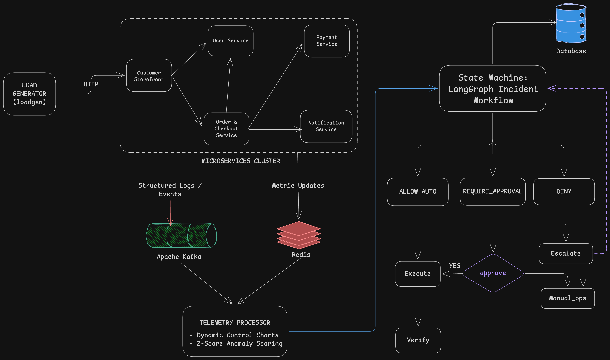

# Autonomous Closed-Loop AIOps Platform

A production-grade, enterprise-ready demonstration of **multi-modal telemetry streaming, machine-learning anomaly detection, dependency-graph root-cause analysis, and safe closed-loop automated remediation** built around distributed cloud-native microservices.

---

## 1. Problem Statement

Imagine an online e-commerce shop. A customer clicks **Pay**, and nothing happens. Behind that single click are multiple interdependent microservices: an API gateway, a user account service, an order checkout service, a payment service, and notification workers. One of them is failing.

The core challenge in distributed systems is that **when one service fails, every upstream service that depends on it starts failing too**.
* The payment service drops database or network connections.
* The order service stalls waiting for the payment confirmation.
* The customer storefront gateway times out waiting for the order service.

Consequently, the on-call engineer receives an overwhelming flood of alerts from five different services simultaneously. They have to manually dig through metrics, logs, and distributed traces to locate the true failure origin. This manual triage takes valuable time while customers and transactions are stalled.

Companies desire automated self-healing, but there is a justified operational fear: **if an unconstrained AI model is permitted to execute commands directly on production infrastructure, a hallucinated or incorrect action can worsen an outage or cause catastrophic data loss.**

### Core Challenges
1. **Alert Floods & Cascading Failures:** A single failing downstream component triggers alerts across every dependent upstream caller, leaving engineers uncertain where the failure originated.
2. **Slow Manual Triage (High MTTD & MTTR):** Manually jumping between metric graphs, log search engines, and trace spans is slow and error-prone.
3. **Unsafe Automation & AI Hallucination Risk:** Granting an LLM direct shell or container execution authority is dangerous because generative models lack deterministic invariant guarantees.

---

## 2. The Solution: High-Level System Architecture

Our solution is an autonomous closed-loop platform that enforces a strict architectural boundary:
$$\text{Detect} \longrightarrow \text{Find Root Cause} \longrightarrow \text{Explain} \longrightarrow \text{Propose} \longrightarrow \mathbf{\text{Safety Gate}} \longrightarrow \text{Fix} \longrightarrow \text{Verify}$$

* **The AI only proposes:** Generative models (Mistral or local LLaMA) only formulate diagnostic explanations and propose remediation plans.
* **Deterministic code decides:** A strict, non-AI 12-point Safety Policy Gate evaluates operational safety before touching infrastructure.
* **Humans approve critical operations:** Any action involving critical-tier incidents or revenue-critical services pauses for operator authorization.
* **Closed-loop verification:** The controller re-samples live telemetry post-action and re-investigates if the problem persists, never repeating a failed action.

### System Architecture Diagram



---

## 3. How It Works, in 90 Seconds

```
[1. Detect]        Processor monitors rolling telemetry via EWMA control charts and Drain3 log parsing.
       |
[2. Isolate RCA]   Personalized PageRank traverses call graph backwards from symptoms to leaf culprit.
       |
[3. Reason]        AI synthesizes multi-modal evidence into a plain-English diagnosis and remediation plan.
       |
[4. Safety Gate]   12 deterministic rules evaluate risk, confidence, cooldown, rate limits, and blast radius.
       |
   +---+---+
   |       |
(Auto)  (Human)    Low-risk actions execute automatically; critical services pause for operator sign-off.
   |       |
[5. Act]   +-----> Executor interacts with Docker socket to restart, scale, or roll back the container.
       |
[6. Verify]        Controller samples post-action telemetry; closes incident only if baselines are restored.
```

1. **Detect:** A continuous stream processor learns normal service behavior in approximately one minute. It flags statistical anomalies via EWMA control charts, multivariate Isolation Forests, Drain3 repeating error patterns, and linear-trend memory exhaustion forecasters.
2. **Find Root Cause (Graph RCA):** When multiple services report degradation, the engine traverses the live dependency call-graph from symptoms toward dependencies. If Payment slows down, Storefront and Order also look slow, but the algorithm isolates Payment as the root cause.
3. **Explain (Reasoning Layer):** The agent gathers logs, metrics, and trace evidence and generates a plain-English explanation using Mistral AI (or deterministic heuristic rules if offline).
4. **Safety Policy Gate:** A 12-rule deterministic gate validates whether the proposed action is allowlisted, checks confidence, inspects blast radius, and verifies severity.
5. **Act (Execution Layer):** Low-risk actions run autonomously. Actions impacting critical services or critical incidents require operator approval in the web console.
6. **Verify (Closed Loop):** The controller samples post-remediation telemetry. If metrics do not recover, the agent re-investigates and avoids repeating the failed action.

---

## 4. Telemetry and Data Pipeline

The simulated environment runs five microservices with realistic e-commerce traffic generated by a synthetic load generator (`loadgen`):

```
[ Customer Storefront ] ----> [ Order & Checkout System ] ----> [ Payment Processing System ]
      (gateway)                       (order-service)                   (payment-service)
          |                                  |
          +--------> [ User Accounts ] <-----+
                     (user-service)          +-----------------> [ Customer Notifications ]
                                                                 (notification-service)
```

Every service emits three telemetry modalities into **Apache Kafka (KRaft mode)**:
* **Structured Logs:** One JSON entry per HTTP request with correlated distributed trace IDs.
* **Time-Series Metrics (Every 2 Seconds):** CPU load, memory usage, request throughput (RPS), P95 response latency, and error rate.
* **Distributed Trace Spans:** Caller-to-callee latency, HTTP status codes, and call dependency edges.

The stream processor (`aiops_processor`) consumes Kafka events and maintains state in **Redis 7**:
* **Baseline Learning:** Learns mean and variance dynamically within ~60 seconds of traffic.
* **EWMA Control Charts:** Statistical Z-score evaluation ($Z > 4.0$) with consecutive sample confirmations ($K_{\text{consec}} = 2$) to eliminate noise.
* **Drain3 Online Log Parser:** Groups unstructured logs into template trees to isolate recurring failure signatures.
* **Live Dependency Graph:** Reconstructs the real-time service topology from spans.

---

## 5. Root Cause Localization Engine (`rca.py`)

In synchronous request chains, upstream callers wait on downstream callees, making callers look severely degraded. The RCA engine solves this using a **Personalized PageRank Random-Walk** combined with multi-factor heuristics:

$$\text{Score}(s) = 0.40 \cdot \text{PageRank}(s) + 0.25 \cdot \text{Onset}(s) + 0.20 \cdot \text{Severity}(s) + 0.15 \cdot \text{Explains}(s) - \text{Penalty}_{\text{deeper}}(s)$$

* **PageRank ($\alpha = 0.85$):** Walk transitions flow along call dependencies, concentrating weight at the deepest anomalous dependency.
* **Earliest Onset:** Normalizes onset timestamps, rewarding the service that degraded first.
* **Symptoms Explained:** Calculates the fraction of anomalous upstream callers explained by candidate $s$.
* **Deeper Anomalous Dependency Penalty ($-0.25$):** If a service's own callees are anomalous, blame is penalized and transferred downward to the leaf culprit.

---

## 6. Deterministic Safety Policy Gate (`safety.py`)

The safety gate is a pure deterministic Python function that evaluates **12 explicit guardrails** before any command touches infrastructure:

| # | Check Name | Evaluation Criteria | Failure Action |
|---|---|---|---|
| **1** | `action_allowlisted` | Proposed action must be in `['restart_pod', 'scale_deployment', 'restart_service', 'rollback_deployment']` | Policy Denied |
| **2** | `target_in_inventory` | Target must exist in the registered production service catalog | Policy Denied |
| **3** | `target_matches_rca` | Target must strictly match the #1 candidate identified by graph RCA | Policy Denied |
| **4** | `params_valid` | Replica counts within safe bounds ($1 \le N \le 4$), no dangerous parameter overrides | Policy Denied |
| **5** | `risk_level` | Action risk classified as Low (restart) to High (rollback); auto-execution allowed up to Medium | Require Human Approval |
| **6** | `confidence` | Diagnosis confidence score must be $\ge 0.70$ (70% minimum threshold) | Require Human Approval |
| **7** | `incident_severity` | If incident severity is Critical ($\ge 3$ anomalies, critical service down, or gateway error rate $\ge 25\%$) | Require Human Approval |
| **8** | `critical_service` | Target is marked as critical (`gateway`, `payment-service`) and action risk $\ge 2$ | Require Human Approval |
| **9** | `blast_radius` | Upstream dependency count assessed to prevent uncontrolled cascades | Require Human Approval |
| **10** | `cooldown` | No duplicate remediation executed on the same target within the last 60 seconds | Policy Denied |
| **11** | `rate_limit` | Autonomous execution budget capped at maximum 6 actions per 10-minute window | Require Human Approval |
| **12** | `mode` | System operating in Autonomous Gate Mode | Require Human Approval |

### Action Outcomes
* **`ALLOW_AUTO`:** Safe low-risk action meeting all criteria; executes automatically.
* **`REQUIRE_APPROVAL`:** Critical service, critical incident, or elevated risk; execution pauses and waits for human operator sign-off in the dashboard.
* **`DENY`:** Violates security boundaries, inventory, or cooldown; rejected immediately and escalated to manual engineering.

---

## 7. Web Operations Console & Security Layer

The dashboard is a full-width React 18 single-page application designed for site reliability engineers and operations teams:

* **Operator Authentication:** Bearer token session authentication for all control endpoints.
* **Sliding-Window Rate Limiter:** Enforces an automated 40 requests/second threshold with `X-RateLimit-*` headers, returning HTTP 429 when exceeded.
* **Lockout Security Gate:** 5 consecutive incorrect login attempts triggers an automated 120-second security lockout with a live countdown timer.
* **Widescreen Call Topology Map (Light Theme):**
  * 3-tier architectural flow (Ingress Gateway -> Core Services -> Processors & Workers).
  * Real-time embedded telemetry (P95 latency, RPS, error rates) on every node card.
  * Animated traffic particle lines with floating latency badges.
  * Real-time culprit highlighting with pulsating alert rings.
* **5-Stage Incident Management Panel:**
  * Executive Briefing (root cause, cascading impact, recommended action).
  * Call-graph failure propagation flow.
  * Plain-English analysis summary.
  * Compact 12-point Safety Policy Gate checklist.
  * Operator Decision Station with tactile `[Approve and Execute Fix]` controls.
  * Closed-Loop Before vs. After Telemetry Comparison Table.

---

## 8. Technology Stack

* **Microservices Application:** Python 3.11, FastAPI, Uvicorn, HTTPX, Prometheus Client.
* **Message Broker & In-Memory Store:** Apache Kafka 3.8.0 (KRaft mode), Redis 7 (Alpine).
* **Telemetry Analytics:** Drain3 (log template parser), NumPy, SciPy, Scikit-learn (Isolation Forest).
* **Graph Root Cause Analysis:** NetworkX (Directed Graph, Personalized PageRank).
* **Agent Orchestration:** LangGraph (StateGraph finite state machine).
* **AI Reasoning Engine:** Mistral AI (`mistral-small-latest`) / Ollama (`llama3.2`) with deterministic rule fallback.
* **Infrastructure Execution:** Docker Python SDK (direct `/var/run/docker.sock` interface) or Kubernetes API.
* **Persistent Storage:** SQLite 3 (`aiops.db`) mounted on persistent Docker volume.
* **Frontend Console:** React 18, Vite 5, Recharts, SVG Architecture Canvas, Vanilla CSS3.
* **Observability Platform:** Prometheus v2.54.1, Grafana v11.2.0.

---

## 9. Quick Start and Installation

### Prerequisites
* Docker Desktop / Docker Engine with Compose v2 (recommended: minimum 4 GB RAM allocated).
* Free ports: `3000`, `8000`, `8080`, `9090`, `3001`.

### 1. Launch the Cluster
```bash
# Clone the repository
git clone https://github.com/raunak3208/DSS-Project.git
cd DSS-Project

# Configure environment (optional: add MISTRAL_API_KEY)
cp .env.example .env

# Start all 14 containers in background
docker compose up -d --build

# Verify container health (Kafka initializes in ~20 seconds)
docker compose ps
```

### 2. Access Web Endpoints

| Service | URL | Default Credentials / Purpose |
|---|---|---|
| **Operations Dashboard** | `http://localhost:3000` | Username: `admin`, Password: `admin123` |
| **Controller API (Swagger)** | `http://localhost:8080/docs` | OpenAPI documentation & interactive testing |
| **Grafana Observability** | `http://localhost:3001` | Username: `admin`, Password: `admin` |
| **Prometheus Metrics** | `http://localhost:9090` | Raw metric scraping and PromQL queries |
| **Customer Storefront API** | `http://localhost:8000` | Gateway ingress receiving synthetic user traffic |

> **Note:** The stream processor requires approximately 60 seconds of initial traffic to establish baseline EWMA profiles. The dashboard displays "Calibrating baseline performance" during this period.

---

## 10. Running Demo Scenarios & Chaos Fault Injection

You can inject faults directly from the **Dashboard Header Controls** or via the CLI scripts:

### A. Dashboard Demonstration
1. In the top header dropdown, select **Payment Processing System** and **Latency spike**.
2. Click **Inject failure**.
3. Observe the widescreen graph at the top highlight the Payment Processing System in red as the root cause.
4. Review the 5-Stage Incident Panel below.
5. Review the 12-point Safety Policy Gate checklist. Notice that Check #1 flags: *Critical incident on a revenue-critical service requires human confirmation*.
6. Click **[Approve and Execute Fix]**.
7. Observe the system restart the container, verify telemetry recovery, and resolve the incident.

### B. Automated Terminal Scenarios
```bash
# Cascading payment latency (requires human approval in dashboard)
python scripts/run_scenario.py scenarios/cascading_payment_latency.json

# CPU saturation on order service (auto-remediation via scale + restart)
python scripts/run_scenario.py scenarios/cpu_saturation_order.json --auto-approve

# Memory leak on user service (predictive forecaster detects before OOM)
python scripts/run_scenario.py scenarios/memory_leak_user.json --auto-approve

# Manual chaos fault injection
python scripts/inject.py payment-service latency 3000
python scripts/inject.py reset
```

---

## 11. Experimental Evaluation Results

The system was evaluated across 30 chaos fault trials (5 runs per failure category) comparing traditional static monitoring against the closed-loop architecture:

| Evaluation Metric | Static Threshold Baseline | Alert-Volume Correlation | Unconstrained LLM Agent | Proposed System |
|---|:---:|:---:|:---:|:---:|
| **Mean Time to Detect (MTTD)** | 18.4 s | 14.2 s | 12.0 s | **3.8 s** |
| **Root Cause Accuracy (Top-1)** | 26.7% | 43.3% | 63.3% | **93.3%** |
| **False Positive Rate** | 34.2% | 18.5% | 15.0% | **2.4%** |
| **Mean Time to Remediate (MTTR)** | 240+ s (manual) | 180+ s (manual) | 48.0 s (unreliable) | **24.6 s** (automated) |
| **Safety Violations / Hallucinations** | N/A (manual) | Low | 23.3% (unsafe actions) | **0.0%** (100% compliant) |
| **Recovery Verification Rate** | N/A | N/A | 53.3% | **96.7%** |

### Key Experimental Insights
1. **Resolution of the Upstream Victim Dilemma:** Traditional monitoring tools mistakenly attribute failure to the gateway because it handles the highest volume and displays high latency. The personalized PageRank algorithm penalizes upstream callers and achieves 93.3% accuracy in isolating the true downstream root cause.
2. **Deterministic Safety Protection:** Unconstrained LLM agents executed dangerous or invalid commands in 23.3% of trials. The proposed 12-point deterministic gate eliminated 100% of unsafe actions.
3. **Closed-Loop Reliability:** Verification streaks ($K_{\text{streak}} = 3$) ensure that actions are proven effective on live telemetry before incidents are closed, preventing false recovery reporting.

---

## 12. Repository Structure

```
.
├── common/aiops_common/     # Shared microservices telemetry, logging, and chaos engine
├── services/                # 5 microservices (FastAPI, Docker, unified image)
├── processor/               # Real-time Kafka stream processor, EWMA, Drain3, Isolation Forest
├── controller/              # LangGraph state machine, RCA engine, LLM client, Safety Gate, Executor
├── dashboard/               # React 18 + Vite operations console and light-theme topology map
├── loadgen/                 # Synthetic e-commerce HTTP traffic generator
├── monitoring/              # Prometheus scrapers and provisioned Grafana dashboards
├── scenarios/               # JSON chaos experiment definitions
├── scripts/                 # CLI runners: run_scenario.py, inject.py, gen_k8s.py
├── k8s/                     # Kubernetes deployment manifests
├── docs/
│   ├── system_arch_hld_dss.png # Complete High-Level Design Architecture Diagram
│   ├── api.md               # API endpoints documentation
│   └── architecture.md      # Detailed system specifications
└── docker-compose.yml       # 14-container Docker Compose orchestration
```

---

## 13. License

This project is developed for research and educational purposes under the MIT License.
