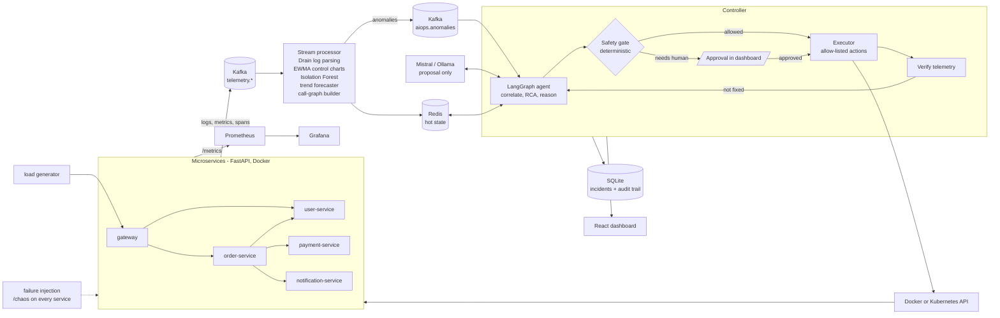

# AIOps closed-loop prototype

A working demonstration of **multi-modal telemetry + AI anomaly detection + dependency-graph root-cause analysis + safe agentic auto-remediation in a closed loop**, built around five simulated cloud-native microservices.

You break a service, and the system detects it, finds the root cause, explains why, decides whether to act, passes the action through a deterministic safety gate (asking a human when the risk is high), executes it, checks that it actually worked, and investigates again if it did not.

## Architecture



**The LLM never executes anything.** It sits inside the `reason` step and returns a JSON *proposal*. That proposal is schema-validated, restricted to root-cause candidates produced by graph analysis and to a four-action allowlist, and then must pass the safety gate. Only the `execute` node touches infrastructure, and it re-validates the action itself.

### What each stage does

| Stage | Code | Technique |
|---|---|---|
| Telemetry | `common/aiops_common` | Every service emits logs, 2s metric windows (CPU, memory, rps, p95, error rate) and spans with trace propagation to Kafka; Prometheus also scrapes `/metrics` |
| Stream processing | `processor/aiops_processor/engine.py` | Consumes Kafka, keeps hot state in Redis |
| Metric anomalies | `detectors.py` | EWMA control chart per metric (baseline frozen while anomalous) + per-service Isolation Forest on recent normal data |
| Log analysis | `drain.py` | Drain-style template mining; alert when an error template repeats |
| Prediction | `detectors.forecast` | Linear-trend fit with R² gate: memory exhaustion, latency SLO breach, CPU saturation ETA |
| Dependency graph | `engine.on_span` | Caller→callee edges built from trace spans with call rate, error rate, latency |
| RCA | `controller/rca.py` | Personalised PageRank over the call graph plus earliest onset, severity, symptoms explained, and a penalty when a candidate's own callees are anomalous |
| Agent | `controller/agent.py` | LangGraph: gather → rca → reason → gate → (approval) → execute → verify → finish, or re-investigate |
| Safety gate | `controller/safety.py` | 12 deterministic checks, see below |
| Remediation | `controller/executor.py` | Docker (Compose), Kubernetes, or simulated backend |
| Verification | `agent.verify_node` | Waits, then requires several consecutive clean polls on every affected service |

### Safety gate

Pure function, no LLM, no I/O, with a per-check audit trail shown in the dashboard. Result is `ALLOW_AUTO`, `REQUIRE_APPROVAL` or `DENY`.

* **Deny:** action not allow-listed · target not a managed service · target not one of the RCA candidates · invalid parameters (e.g. replicas out of range) · same action on same target inside the cooldown
* **Require a human:** risk above `AUTO_MAX_RISK` (rollback is always high) · confidence below `MIN_CONFIDENCE` · **incident severity is critical** · restarting a critical service (gateway, payment) · large blast radius · auto-action rate limit hit · mode set to "ask before every fix"

| Action | Risk | Runs by itself? |
|---|---|---|
| `restart_pod` | low | yes, unless severity is critical or target confidence is low |
| `scale_deployment` (up, capped) | low | yes, same conditions |
| `restart_service` | medium | yes for non-critical services |
| `rollback_deployment` | high | never, always a human |

An incident becomes **critical** when three or more services are anomalous, a critical service is down, or the gateway error rate reaches 25%. Critical incidents always wait for a human, who sees the evidence, the explanation and the gate checklist before pressing Approve or Reject. Unanswered requests escalate after `APPROVAL_TIMEOUT_S`.

### Closed loop

After an action, the agent waits, re-reads telemetry and checks every affected service. If it is not fixed, the history of failed attempts goes back into the workflow and the agent investigates again. It will not repeat an action that already failed, and after `MAX_ITERATIONS` it escalates to a human. Example from the CPU scenario: scaling out halves the load but does not clear the anomaly, so the second pass moves on to restarting the pod.

## Run it

Requirements: Docker with Compose v2 (about 3 GB RAM free). Ports used: 3000, 8000, 8080, 9090, 3001.

```bash
cp .env.example .env              # optional: add a free MISTRAL_API_KEY; without it the rule-based reasoner is used
docker compose up --build -d
docker compose ps                 # wait until everything is running (Kafka takes ~30 s)
```

| URL | What |
|---|---|
| http://localhost:3000 | **Dashboard** (start here) |
| http://localhost:8080/docs | Controller API (Swagger / OpenAPI) |
| http://localhost:3001 | Grafana (provisioned "AIOps services" dashboard; admin / admin) |
| http://localhost:9090 | Prometheus |
| http://localhost:8000 | Gateway (the "customer-facing" API) |

The processor needs about a minute of traffic to learn each service's baseline; the dashboard says "Learning normal behaviour" until then. Detection is deliberately silent during that time.

### Run a demo scenario

In the dashboard pick a service and a failure type, then press **Inject failure**. Or from a terminal (standard-library Python only):

```bash
python scripts/run_scenario.py scenarios/cpu_saturation_order.json --auto-approve
python scripts/run_scenario.py scenarios/cascading_payment_latency.json    # waits for YOU to approve in the dashboard
python scripts/inject.py payment-service latency 3000                      # manual injection
python scripts/inject.py reset
```

| Scenario | Expected behaviour |
|---|---|
| `cpu_saturation_order` | Root cause order-service. Scale out (auto) → verification fails → agent re-investigates → restart pod (auto) → verified. |
| `memory_leak_user` | Forecaster predicts exhaustion; restart pod (auto) before the heap limit. |
| `cascading_payment_latency` | Latency in payment propagates to order and gateway. RCA blames payment. Incident is critical → **human approval** → restart pod → verified. |
| `crash_payment` | Callers fail, heartbeat alarm fires, RCA blames the dead service. Restart of a critical service → **human approval**. |
| `bad_deploy_notification` | Release v2 throws errors. Rollback → **human approval**. A restart would not help because the bad release is the desired state. |

`run_scenario.py` prints the live narrative and compares the outcome against the `expect` block in the scenario file. The scenarios can also be driven entirely from the dashboard, where you will see the loop strip light up, the root-cause ranking, the explanation, the gate checklist, the Approve / Reject box, and the before/after table.

### Use a free LLM (optional)

```bash
# Mistral (free tier): get a key at https://console.mistral.ai
MISTRAL_API_KEY=xxxx            # in .env, LLM_PROVIDER=mistral is the default

# Ollama on your machine instead (no code change):
ollama pull llama3.2
# .env:  LLM_PROVIDER=ollama   LLM_MODEL=llama3.2   LLM_BASE_URL=http://host.docker.internal:11434/v1
docker compose up -d controller
```

All providers use the OpenAI-style `/chat/completions` protocol (`controller/aiops_controller/llm.py`), so any compatible server works with `LLM_PROVIDER=openai_compat`. If the LLM is missing, slow, returns invalid JSON or proposes something out of bounds, the agent falls back to its deterministic reasoner and records why.

### Kubernetes (optional)

Manifests are in `k8s/` (generated by `scripts/gen_k8s.py`). With kind or minikube:

```bash
docker build -t aiops/svc:latest        -f services/Dockerfile .
docker build -t aiops/processor:latest  -f processor/Dockerfile .
docker build -t aiops/controller:latest -f controller/Dockerfile .
docker build -t aiops/dashboard:latest  dashboard/
kind load docker-image aiops/svc:latest aiops/processor:latest aiops/controller:latest aiops/dashboard:latest   # minikube: minikube image load 
kubectl apply -f k8s/
kubectl -n aiops create secret generic aiops-llm --from-literal=MISTRAL_API_KEY=xxxx   # optional
kubectl -n aiops port-forward svc/dashboard 3000:80
```

The controller runs with `EXECUTOR_BACKEND=k8s` and a Role limited to deleting pods and patching/scaling deployments in the `aiops` namespace. `restart_pod` deletes the pod with the most restarts, `restart_service` does a rolling restart, `scale_deployment` patches the scale subresource. Chaos injection via the controller reaches whichever pod the Service routes to.

### Tests

```bash
python -m venv .venv && . .venv/bin/activate
pip install -r controller/requirements.txt -r processor/requirements.txt -r services/requirements.txt -r requirements-dev.txt
python -m pytest tests -q
```

20 fast tests (about 40 s) plus 1 slow test, no Docker or Kafka needed:
* unit tests for Drain, EWMA, the forecaster, graph RCA, and every safety-gate policy
* LLM guardrail tests (hallucinated service, dangerous action, repeated action, provider failure, provider swap)
* API smoke tests
* **real-telemetry validation** (`python -m pytest -m slow`, about 100 s): the five real FastAPI apps run in one process, their genuine logs, metrics and spans feed the real processor engine and RCA. It asserts no false positives during normal operation, detection and correct blame in a payment latency cascade, a call graph learned from real spans, recovery clearing, and bad-deploy detection
* **end-to-end closed-loop tests**: a synthetic world feeds telemetry into the real processor engine, the real LangGraph agent and gate decide, and a simulated executor changes the world. They cover CPU (scale fails → re-investigate → restart), cascading latency (critical → approval → fix), rejected rollback (never executed), approved rollback, crash with approval, "ask before every fix" mode, and no false incident during normal operation.

## Layout

```
common/aiops_common/   shared service library: telemetry, tracing, fault injection, app factory
services/              the five microservices (one image; SERVICE_NAME selects the role)
loadgen/               synthetic traffic
processor/             stream processing + ML detectors (Kafka -> Redis + anomalies topic)
controller/            RCA, LangGraph agent, LLM client, safety gate, executors, API, SQLite store
dashboard/             React + Vite (served by nginx, proxies /api to the controller)
monitoring/            Prometheus config, Grafana datasource + dashboard
k8s/                   Kubernetes manifests          scenarios/  failure scenarios
scripts/               run_scenario.py, inject.py, gen_k8s.py       docs/  API + design notes
```

## Honest limitations

* **Verified here:** the Python logic is covered by the 20 tests above, the five microservices were run as live processes (request flow, tracing, latency cascade, CPU fault, bad deploy, crash), the real apps' telemetry was run through the processor and RCA (slow test above; CPU/memory excluded because the apps share one process there),
  the controller API was exercised in-process, the dashboard builds, and all Kubernetes manifests parse. **Not run in this environment:** `docker compose up` (no Docker daemon here), real Kafka, a real Mistral/Ollama call, the Docker/Kubernetes executors against live infrastructure, and the dashboard in a browser. Expect to tune detector thresholds (`CHARTS` and `Z` in `engine.py`) and timing values the first time you run the full stack.
* **OpenTelemetry:** traces use an OTel-style span schema (trace id, span id, parent, peer, duration, status) propagated through headers by hand rather than the OTel SDK. Swapping in the OTel SDK and Collector is a contained change in `aiops_common`, but it is not done.
* **Simulated faults:** CPU, memory, latency, error and crash faults are real effects inside the service process. Scaling is simulated (a Redis replica count that divides the CPU-fault penalty), and a "bad deployment" is a desired-version flag in Redis that only a rollback clears. This is what lets the demo work in plain Docker Compose.
* **Single incident at a time**, and the service inventory and criticality are static config (`controller/aiops_controller/config.py`), deliberately not derived from telemetry.
* The Docker executor needs the host Docker socket mounted into the controller. That is fine for a local demo and not something to copy into production.
* The dashboard polls every 2 seconds rather than streaming.
* No authentication on the controller API or dashboard.
