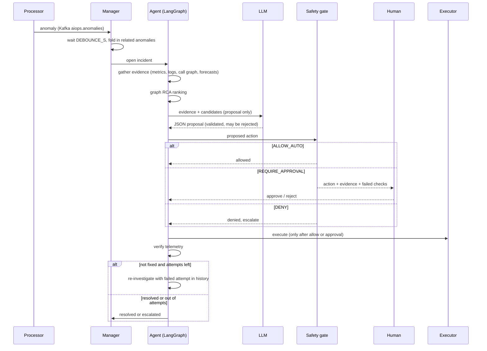

# Design notes

## Why these choices

* **Kafka between services and processor.** Telemetry is decoupled from detection, so the processor can lag, restart or scale without touching the services. Anomalies are also a topic, so more consumers (alerting, ticketing) can subscribe later.
* **Redis for hot state.** The processor writes the latest state, 8 minutes of series, active anomalies, log templates and the call graph; the controller and dashboard read it. Redis also carries the *desired* version and replica count, which is what makes scale and rollback real, observable actions.
* **Control charts first, ML second.** EWMA z-scores with an absolute-deviation floor are cheap, explainable and fast to learn. The Isolation Forest only raises *low* severity signals, so it can corroborate but never open an incident by itself. This keeps false positives off the critical path.
* **Graph RCA instead of "highest anomaly score".** In a cascade the loudest service is usually a victim. Walking caller→callee from the symptoms and penalising candidates whose own callees are anomalous moves blame to the deepest cause.
* **Deterministic safety gate between reasoning and action.** The LLM can be wrong, slow or manipulated through log text. Policy is code, evaluated on trusted inventory (static config), not on model output or telemetry alone.
* **Verification re-reads telemetry, it does not trust the executor's exit code.** "The command succeeded" and "the incident is fixed" are different facts.

## Sequence of one incident

## Extending it

* **New service:** add it to `STATIC_TOPOLOGY` and `INVENTORY` in `controller/aiops_controller/config.py`, give it a route function in `services/svc/main.py`, add it to Compose, Prometheus and the dashboard `POS` layout.
* **New remediation:** add it to `RISK` in `safety.py`, `PLAYBOOK` and `ACTIONS` in `reasoner.py`, and an `Executor` method. It will not run until all three agree.
* **New detector:** emit anomalies through `Engine._raise`; give each a stable `type` so the playbook can map it to a fault signature in `reasoner.classify`.
* **Real infrastructure:** point `EXECUTOR_BACKEND=k8s` and replace the Redis-flag rollback in `K8sExecutor.rollback` with a ReplicaSet-based rollback.
